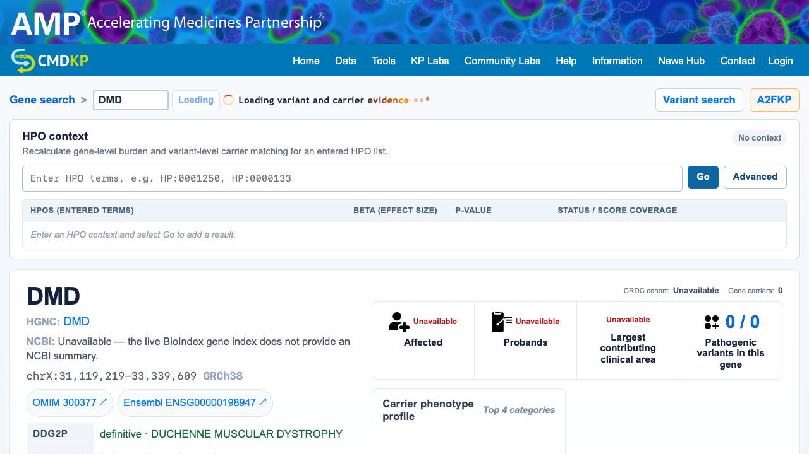
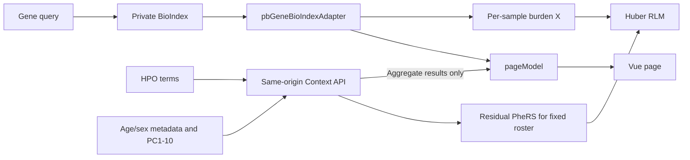

# pb_Gene Production Integration Handoff

Updated: 2026-11-12 (precomputed association DB delivery and carrier integration)
Target branch: `kyuryung/bch-prototype`  
Revision: use the delivered branch HEAD; production deployment is separate

This is the starting document for an engineer or AI agent integrating the
tested `pb_Gene` page into the production BCH portal.

For the current `pb_gene2.html` screen, start with the concise
[Gene2 integration handoff](pb_gene2_engineering_handoff_20261112.md).
The original `pb_Gene.html` notes below remain applicable to that page.

## Current precomputed association delivery — November 12, 2026

The authoritative data-import and q-field contract is
[Precomputed association DB import](pb_gene_context_association_engineering_handoff.md#precomputed-association-db-import--november-12-2026).
Helen should import the 361 MB `browser_gene_hpo.jsonl.gz` from the consolidated
`single_gene_burden_with_HPO/gene_hpo_release_20261112/` server release into the
association DB/BioIndex, with gene and HPO lookup indexes. It contains all PASS
`p_value < 0.05` pairs (2,337,904 rows), not a top-15 projection. The linked
contract provides the absolute path, SHA-256 and verification details.

Gene uses `q_by_gene`/`q_significant_by_gene`/`n_q_significant_by_gene`;
Phenotype uses `q_by_hpo`/`q_significant_by_hpo`. Both adjustments were calculated
before delivery filtering. Do not recompute q on visible/delivered rows or use
the legacy HPO-wise flags for Gene. The source JSONL is not a browser download
or an already indexed DB; update data ingestion and page mappings together.
The release's `internal/` folder is not part of the runtime delivery.

## Start With the Mockup

Run the BCH prototype and compare the production implementation directly
against:

<http://127.0.0.1:8095/pb_Gene.html?query=DMD>

The mockup is the visual and interaction reference. It also demonstrates the
large-gene loading state, complete BioIndex continuation handling, score
labels, sorting, row expansion, and explicit unavailable states. Do not
reconstruct the behavior from screenshots alone when the local page is
available.

The loading screenshot is retained as a secondary reference:



## What Is Ready

| Area | Required production behavior |
|---|---|
| Gene loading | Render gene identity first, then show the orange spinner, dots, and text sweep while all variant and carrier continuations load |
| Gene links | Existing HGNC text, OMIM ID, and Ensembl ID open their external records |
| External portal | `A2FKP` opens <https://a2f.hugeamp.org/> |
| Extended Pathogenic Score | Display score priority is LoFTEE HC, AlphaMissense, then REVEL |
| Burden Pathogenic Score | Model/table score uses LoFTEE HC, then AlphaMissense; REVEL is excluded |
| REVEL-only row | Red `—*`, sorted after numeric scores and before fully missing rows |
| Evidence count | Variants with any LoFTEE, AlphaMissense, or REVEL value divided by all observed variants |
| ClinVar | Restrained red Pathogenic and orange Likely pathogenic badges; never color the whole row |
| Variant row | Opens/closes evidence and switches carrier statistics without replacing the phenotype profile component |
| Classification | Long values wrap inside the table cell |
| Match Score | Mean residual PheRS across every unique carrier of that variant |

For DMD, the tested full-continuation result showed 6,132 unique carriers,
20/870 variants with pathogenicity evidence, and 870 total variants. These
counts are validation references, not hard-coded values.

## Runtime Boundary



The browser must never receive patient-level residual PheRS, HPO profiles, or
the complete covariate matrix. Production needs an authenticated same-origin
route:

```http
POST /phenotype-analyzer-api/analyze
```

The local Vue proxy and `scripts/pb_gene_context_api_server.py` are reference
implementations, not a production deployment.

## Files the Engineer Must Read

| Path | Responsibility |
|---|---|
| `src/views/PbGene/Template.vue` | Page composition, table, row interaction |
| `src/views/PbGene/GeneIdentityPanel.vue` | Gene identifiers and external links |
| `src/views/PbGene/HpoContextPanel.vue` | HPO form and minimum-carrier control |
| `src/views/PbGene/pageModel.js` | State, sorting, Context API request/merge |
| `src/views/PbGene/pbGeneBioIndexAdapter.js` | BioIndex mapping, deduplication, continuations, cache |
| `src/views/PbGene/style.css` | Tokens, loading motion, table wrapping |
| `scripts/context_api_fast.py` | Match Score and Huber RLM reference calculations |
| `scripts/pb_gene_context_validation.py` | Cohort alignment and covariate encoding |
| `docs/pb_gene_context_api_guide.md` | Exact calculation and data contract |
| `docs/pb_gene_context_api_review_checklist.md` | Remaining production approvals |

## Production Wiring

The frozen processed-data build, exact input hashes, output schemas, rerun
command, and BioIndex materialization rules are documented in
`docs/pb_front_gene_variant_merge_handoff.md`, section **Cross-page processed
BioIndex handoff (2026-09-07)**. Read that section before replacing or
extending `gene-samples`. The canonical carrier artifact is flat at
`sample_id × variant_id × gene_symbol`; it is not a nested per-sample document.

1. Expose the `pbGene` page entry in the production Vue build.
2. Use the production private BioIndex client and follow every
   `/api/bio/cont` continuation before final counts or burden calculations.
3. Deploy the Context API behind the portal's authenticated same-origin route.
4. Source age and sex from approved sample metadata.
5. Compute PC1-PC10 once from the approved cohort PCA workflow and align the
   saved results one-to-one by `sample_id`.
6. Keep missing metadata explicit; do not fabricate values in the browser.
7. Return aggregate model and per-variant Match Score results only.

## Current Statistical Defaults

- Minimum positive-burden carrier count: **10**, enforced by UI and reference API.
- Age: only finite values from 0 through 99 are valid. Everything else is
  Unknown, median-imputed, and marked with `age_missing=1`.
- Sex: only Female and Male are retained. Every other value is Unknown.
- No sample is excluded solely because age or sex is Unknown.
- Female is the model reference; `sex_male` and `sex_unknown` are indicators.
- RLM inference decision for portal v1: use the tested MASS
  `summary.rlm(method="XtX")`-style standard error and label the two-sided
  normal P-value as an approximation. See the API guide for rationale.
- Context result rows below 10 positive-burden carriers show a red Note that
  the result must not be interpreted or relied upon.

## Staging Acceptance

- Compare DMD against the local mockup at the URL above.
- Verify large-gene counts use every continuation page.
- Verify the default and minimum allowed carrier threshold are both 10.
- Verify an under-supported result shows the red interpretation warning in the
  Note column.
- Submit a valid HPO context and confirm the response includes the exact model
  formula, sample count, score versions, and structured status.
- Verify an age of 100, a negative/non-numeric age, and any non-Male/Female sex
  remain in the cohort but are encoded as Unknown.
- Verify no patient-level values appear in the browser response or logs.
- Run the documented Python tests and `npm run build`.

## Copy-Paste Request for the Production AI Agent

> Integrate the current `kyuryung/bch-prototype` pb_Gene implementation into
> the production portal. First inspect the running mockup at
> `http://127.0.0.1:8095/pb_Gene.html?query=DMD`, then read
> `docs/pb_gene_production_integration_handoff.md`,
> `docs/pb_gene_context_api_guide.md`, and
> `docs/pb_gene_context_api_review_checklist.md`. Preserve complete BioIndex
> continuations, Extended/Burden score separation, carrier deduplication,
> minimum 10 positive-burden carriers, age/sex Unknown encoding, aggregate-only
> Context API responses, and existing row interactions. Adapt routing,
> authentication, and service configuration only where required by production.
> Report any deviation before merging.

### November 12: carrier metadata cache and deployed Sample lookup check

Gene carrier aggregation reads the private `samples-info` index keyed by the exact
`SampleInVCF` value. The deployed `/sampleresult.html` bundle inspected on November
12 queried a canonical sample ID without the `_E38`/`_G38` suffix and therefore
reported metadata unavailable. A direct check returned no records for the
canonical key or `_E38`, and one metadata record for `_G38`. The repository's
`PbSample/pbSampleBioIndexAdapter.js` already tries the two supported suffixes.
The browser bundle exposes individual BioIndex requests, not an original S3
object location or a bulk metadata download.

`gene_carrier_disk_cache.js` preserves successful normalized metadata, exact gene
carrier sets and completed summaries across local server restarts for 24 hours.
The namespace separates BioIndex host, hashed authorization scope and the build
timestamps/schema of `samples-info` and `gene-variants-crdc`. Incomplete or failed
lookups are not saved. Cache files remain outside the repository under the OS
temporary directory (`pb-gene-carrier-cache-v1`), with private directory/file
permissions; `PB_GENE_CARRIER_CACHE_DIR` overrides the location. Disk cache failure
falls back to the existing live requests. A completed summary is reused only if
all corresponding metadata records remain available, preserving variant and locus
filter behavior.

`BIOINDEX_HOST_PRIVATE=<private-host> node scripts/warm_gene_carrier_cache.js GJB2`
fills the same cache without opening an HTTP listener and logs aggregate progress
only. This prevents a first visit after a development server restart from
repeating thousands of individual requests once the source has been cached. A
genuinely cold source still requires the per-sample calls; a production bulk
metadata export would remove that remaining cost.

Validation: `test_gene_carrier_disk_cache.js` checks restart reuse, expiration,
source namespace separation, private permissions and interrupted writes.
`test_gene_carrier_restart_cache.js` checks endpoint reuse, session isolation and
invalidation after a source rebuild. Existing summary and selected-demographics
tests remain applicable.

Local live verification on November 12: the initial GJB2 cache fill completed
16,143/16,143 metadata records in 552 seconds. After restarting the Vue server,
the completed summary became available in 1.957 seconds; a repeated request took
0.016 seconds. Demographics, 19,151 co-carrier gene counts and 6,524 phenotype
counts matched the previous completed result. A two-carrier variant selection
completed in 0.064 seconds and every demographic section summed to two. These
measurements are for the local server, not the deployed portal.

For uniformly fast first visits in production, prepare the full authorized cohort
metadata and gene/variant carrier membership on the server before publishing a
source build, and precompute the default gene summaries. Arbitrary variant
selections should union carrier IDs and aggregate the server-local metadata,
instead of issuing sample-by-sample BioIndex calls. The local cache implementation
does not by itself deploy this production data preparation or replace the
production service/authentication integration.
